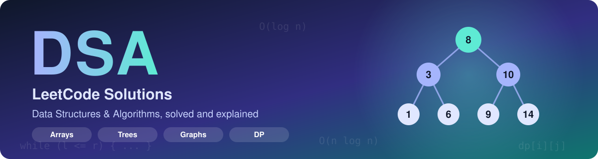
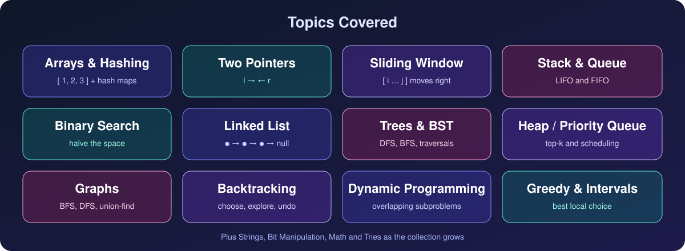
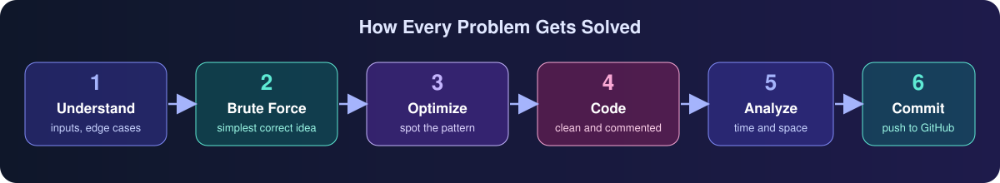
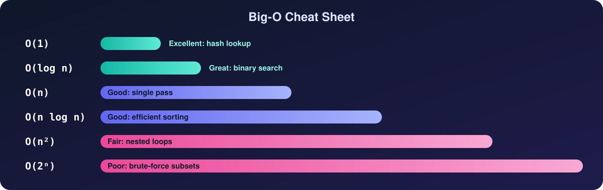
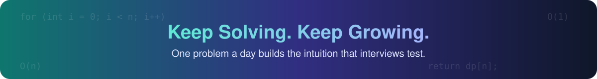

<div align="center">



<br/>


<br/>

[](https://leetcode.com/)

</div>

---

## 📌 Overview

**DSA** is my personal collection of **LeetCode solutions**. Every problem I solve lands here with
clean, commented code, the idea behind the approach, and its **time and space complexity**. The
goal is simple: build strong problem-solving instincts, one problem at a time, and keep a record
I can revisit before interviews.

> 💡 Each solution is written to be read, not just run. If you are learning DSA, follow the
> approach notes first and try the problem yourself before looking at the code.

---

## 🎯 What You'll Find Here

<table>
<tr><td width="33%" valign="top">

### 🧠 Clear Approaches
- Brute force first, then the optimized idea
- Why the pattern works
- Edge cases worth remembering

</td><td width="33%" valign="top">

### ⏱️ Complexity Analysis
- Time complexity for every solution
- Space complexity for every solution
- Trade-offs between approaches

</td><td width="34%" valign="top">

### 🗂️ Organized by Topic
- Arrays, Strings, Linked Lists
- Trees, Graphs, Heaps
- DP, Greedy, Backtracking

</td></tr>
</table>

---

## 🧩 Topics Covered



Problems are grouped by the data structure or technique they train, so it is easy to practice one
topic at a time.

---

## 🔄 My Problem-Solving Approach



I never jump straight to code. I make sure I understand the problem, find a correct baseline,
then look for the pattern that makes it faster. Only then do I write the final solution and
analyze its cost.

---

## ⏱️ Big-O Cheat Sheet



A quick reminder of how common complexities compare. Every solution here states its time and
space complexity so you can see which trade-offs were made.

---

## 📊 Progress Tracker


<!-- PROGRESS:START -->
| Difficulty | Solved |
|---|---|
| 🟢 Easy | 6 |
| 🟡 Medium | 21 |
| 🔴 Hard | 2 |
| **Total** | **29** |
<!-- PROGRESS:END -->

> 🤖 These numbers update automatically every time I push a new solution.

---

## 🧾 Solution Format

Every solution file is named `number-problem-name.ext` (for example `0856-score-of-parentheses.py`)
and starts with the same header, so it is quick to scan:

```python
"""
856. Score of Parentheses
Difficulty: Medium
Topic: Stack
Link: https://leetcode.com/problems/score-of-parentheses/

Approach:
    The core idea in a few lines.

Complexity:
    Time:  O(n)
    Space: O(n)
"""

class Solution:
    ...
```

---

## 🤖 Self-Updating README

A GitHub Action runs on every push. It reads the header of each solution file, then rewrites the
**Progress Tracker** and the **Problem Log** automatically, including links to the code and to any
problem images. Add a solution, push, and the README updates itself.

---

## 🗒️ Problem Log

<!-- LOG:START -->
| # | Problem | Topic | Difficulty | Solution |
|---|---|---|---|---|
| 1 | [Two Sum](https://leetcode.com/problems/two-sum/) | Junior, Array, Hash Table | 🟢 Easy | [Python](./Solutions/1_Two_Sum.py) |
| 2 | [Add Two Numbers](https://leetcode.com/problems/add-two-numbers/) | Linked List, Math | 🟡 Medium | [Python](./Solutions/2_Add_Two_Numbers.py) |
| 4 | [Median of Two Sorted Arrays](https://leetcode.com/problems/median-of-two-sorted-arrays/) | Array, Sorting | 🔴 Hard | [Python](./Solutions/4_Median_of_Two_Sorted_Arrays.py) |
| 7 | [Reverse Integer](https://leetcode.com/problems/reverse-integer/) | Math | 🟡 Medium | [Python](./Solutions/7_Reverse_Integer.py) |
| 8 | [String to Integer (atoi)](https://leetcode.com/problems/string-to-atoi/) | String | 🟡 Medium | [Python](./Solutions/8_String_to_Atoi.py) |
| 9 | [Palindrome Number](https://leetcode.com/problems/palindrome/) | Math, Two Pointers, String | 🟢 Easy | [Python](./Solutions/9_Palindrome.py) |
| 11 | [Container With Most Water](https://leetcode.com/problems/container-with-most-water/) | Array, Two Pointers, Greedy | 🟡 Medium | [Python](./Solutions/11_Container_with_most_water.py) |
| 12 | [Integer to Roman](https://leetcode.com/problems/integer-to-roman/) | Hash Table, Math, String, Greedy | 🟡 Medium | [Python](./Solutions/12_Integer_to_Roman.py) |
| 14 | [Longest Common Prefix](https://leetcode.com/problems/longest-common-prefix/) | Array, String | 🟢 Easy | [Python](./Solutions/14_Longest_Common_Prefix.py) |
| 15 | [3Sum](https://leetcode.com/problems/3sum/) | Array, Two Pointers, Sorting | 🟡 Medium | [Python](./Solutions/15_3Sum.py) |
| 16 | [3sum Closet](https://leetcode.com/problems/3sum-closet/) | Array, Two Pointers, Sorting | 🟡 Medium | [Python](./Solutions/16_3Sum_Closet.py) |
| 17 | [Letter Combinations of a Phone Number](https://leetcode.com/problems/letter-combinations-of-phone-number/) | String, Backtracking, Recursion | 🟡 Medium | [Python](./Solutions/17_Letter_Combinations_of_Phone_Number.py) |
| 18 | [4Sum](https://leetcode.com/problems/4sum/) | Array, Two Pointers, Sorting | 🟡 Medium | [Python](./Solutions/18_4sum.py) |
| 19 | [Remove Nth Node From End of List](https://leetcode.com/problems/remove-nth-node-from-end/) | Linked List, Two Passes | 🟡 Medium | [Python](./Solutions/19_Remove_nth_node_from_end.py) |
| 23 | [Merge k Sorted Lists](https://leetcode.com/problems/merge-k-sorted-lists/) | Linked List, Divide and Conquer, Merge Two Sorted Lists | 🔴 Hard | [Python](./Solutions/23_merge_k_sorted_lists.py) |
| 24 | [Swap Nodes in Pairs](https://leetcode.com/problems/swap-nodes-in-pairs/) | Linked List, Recursion, Pointer Manipulation | 🟡 Medium | [Python](./Solutions/24_swap_nodes_in_pairs.py) |
| 36 | [Valid Sudoku](https://leetcode.com/problems/valid-sudoku/) | Array, Hash Table, Matrix | 🟡 Medium | [Python](./Solutions/36_Valid_Sudoku.py) |
| 43 | [Multiply Strings](https://leetcode.com/problems/multiply-strings/) | String, Math, Simulation | 🟡 Medium | [Python](./Solutions/43_Multiply_Strings.py) |
| 45 | [Jump Game II](https://leetcode.com/problems/jump-game2/) | Array, Greedy | 🟡 Medium | [Python](./Solutions/45_Jump_Game2.py) |
| 48 | [Rotate Image](https://leetcode.com/problems/rotate-image/) | Array | 🟡 Medium | [Python](./Solutions/48_Rotate_Image.py) |
| 678 | [Valid Parenthesis String](https://leetcode.com/problems/valid-parenthesis-string/) | Stack, Dynamic Programming, Top-Down Approach | 🟡 Medium | [Python](./Solutions/678_Valid_Parenthesis_String.py) |
| 856 | [Score of Parentheses](https://leetcode.com/problems/score-of-parentheses/) | String | 🟡 Medium | [Python](./Solutions/856_Score_of_Parentheses.py) |
| 921 | [Minimum Add to Make Parentheses Valid](https://leetcode.com/problems/minimum-add-to-make-parentheses-valid/) | Stack | 🟡 Medium | [Python](./Solutions/921_Minimum_Add_to_Make_Parentheses_Valid.py) |
| 1021 | [Remove Outetmost Parenthesis](https://leetcode.com/problems/remove-outetmost-parenthesis/) | Stack, String | 🟢 Easy | [Python](./Solutions/1021_Remove_OutetMost_Parenthesis.py) |
| 1541 | [Minimum Insertions to Balance a Parentheses String](https://leetcode.com/problems/min-insertions-to-balance-parenthesis/) | Stack, Greedy | 🟡 Medium | [Python](./Solutions/1541_Min_Insertions_To_Balance_Parenthesis.py) |
| 2089 | [Find Target Indices After Sorting Array](https://leetcode.com/problems/find-target-array-after-sorting/) | Array, Counting, Sorting | 🟢 Easy | [Python](./Solutions/2089_find_target_array_after_sorting.py) |
| 2778 | [Sum of Squares of Special Elements ](https://leetcode.com/problems/sum-of-squares-of-special-elements/) | Array, Math | 🟢 Easy | [Python](./Solutions/2778_Sum_of_squares_of_special_elements.py) |
| 2913 | [Subarrays Distinct Element Sum Of Squares](https://leetcode.com/problems/subarrays-distinct-element-sum-of-squares/) | Array, Hash Set, Sliding Window | 🟡 Medium | [Python](./Solutions/2913_Subarrays_Distinct_Element_Sum_of_Squares.py) |
| 3727 | [Maximum Alternating Subsequence Sum](https://leetcode.com/problems/max-alternating-sum-squares/) | Array, Sorting, Greedy | 🟡 Medium | [Python](./Solutions/3727_Max_Alternating_Sum_Squares.py) |
<!-- LOG:END -->

---

## 🚀 Getting Started

```bash
git clone https://github.com/gundatejeswararao7/DSA.git
cd DSA
```

Open any topic, pick a problem, and read the approach before the code. To run a solution, use the
compiler or interpreter for the language it is written in.

---

## 🌱 Contributing

Found a bug or a cleaner approach? Suggestions are welcome.

```bash
git checkout -b improve/problem-name
# make your changes and test them
git add .
git commit -m "Improve solution for problem-name"
git push origin improve/problem-name
```

Then open a pull request.

---

## 📄 License

This repository is for learning and practice. Add an open-source license if you want others to
reuse the code.

---

<div align="center">

## 📫 Author

**Gundatejeswararao7**

[](https://github.com/gundatejeswararao7)
[](https://leetcode.com/)

## ⭐ Support

If this repo helps your prep, consider giving it a star.

<br/>



</div>
